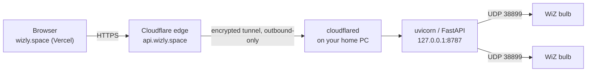

# Deploying Wizly: Vercel frontend + a backend that can still reach your bulbs

## The constraint that decides everything

WiZ bulbs only speak **UDP** on port 38899/38900, to **private LAN addresses**
(`192.168.x.x` / `10.x.x.x`), and discovery needs a UDP **broadcast** on that same LAN.

That means `backend/` (FastAPI + pywizlight, holding raw UDP sockets) **cannot run as a
Cloudflare Worker or Pages Function**. Workers have no raw UDP support and no route to
RFC1918 addresses — they run in Cloudflare's network, not yours. This isn't a
configuration problem to work around; it's a hard platform limit. The same is true of
most "serverless" clouds (Vercel Functions, Lambda, etc.) — none of them sit on your home
LAN.

So the real backend process has to keep running on **a machine physically on your home
network** — your laptop, or better, a small always-on box (Raspberry Pi, mini PC, old
machine, NAS with Docker). "Deploying the backend on Cloudflare" then means: *Cloudflare
becomes the public front door (DNS + edge + tunnel), while your UDP-capable Python
process keeps running at home.* That's a completely standard pattern and it's what the
rest of this guide sets up.



## Where Tailscale fits (and where it doesn't)

The snippet you pasted describes a **different** shape: a cloud VM runs your backend
logic, and it reaches a home machine's Tailscale IP to get to the LAN. That's a valid
pattern, but note two things before picking it:

1. **Tailscale can't run inside Cloudflare Workers either.** It's a daemon you install on
   a real OS (a VM, a Pi, your laptop). So "backend on Cloudflare" + "Tailscale to home"
   would really mean: a thin relay on some VM (DigitalOcean, Fly.io, a Cloudflare
   Container, etc.) with Tailscale installed, calling your home machine's Tailscale IP —
   Cloudflare itself would only ever be DNS/CDN in front of that VM, not the compute.
2. Tailscale is for when a **non-Cloudflare cloud VM** needs LAN access (e.g. you want a
   relay that's up even if your home internet hiccups, or you're adding auth/queueing in
   the cloud). If the backend simply runs at home — as it does today — **Cloudflare
   Tunnel alone is simpler and gets you `api.wizly.space` with no extra moving parts and
   no VM to pay for or patch.**

Given you've already built this as "FastAPI running next to the bulbs," **Cloudflare
Tunnel is the recommended path** below. Tailscale is covered afterward as the variant to
use if you later want the public-facing piece to run somewhere other than your home PC.

The `awesome-tunneling` list is a good reference if you ever want to swap `cloudflared`
for `ngrok`, `frp`, `rathole`, etc. — the DNS/tunnel step is the only part that changes.

---

## Part 1 — Code changes already made

So the split frontend/backend setup works at all, this pass added:

- **`frontend/src/lib/api.ts`** now prefixes every request with `API_BASE_URL` (a
  build-time env var). Empty/unset in dev, so Vite's existing `/api` proxy still works
  unchanged. Set it in Vercel for production so the deployed frontend calls your real
  backend host instead of its own Vercel origin.
- **`frontend/src/vite-env.d.ts`** types that env var.
- **`backend/main.py`** CORS now reads `WIZLY_ALLOWED_ORIGINS` (comma-separated exact
  origins) and `WIZLY_ALLOWED_ORIGIN_REGEX` (one regex, e.g. for Vercel previews) instead
  of a hardcoded localhost-only list.
- **`.env.example`** in both `frontend/` and `backend/` documents the variables (the
  backend doesn't auto-load `.env` files — set the variables in whatever runs uvicorn).

## Part 2 — Set the frontend's backend URL (Vercel)

1. Vercel dashboard → your project → **Settings → Environment Variables**.
2. Add `API_BASE_URL` = `https://api.wizly.space` for the **Production** environment
   (add it for Preview too if you want preview deployments to hit the same backend).
3. Redeploy (env var changes need a new build to take effect in a Vite app).

## Part 3 — Put `wizly.space` on Cloudflare

1. Cloudflare dashboard → **Add a site** → `wizly.space`.
2. Cloudflare gives you two nameservers. Set those as your domain's nameservers at your
   registrar. (Vercel can still serve the apex/`www` — you'll add a DNS record for that
   *inside* Cloudflare instead of using Vercel's own nameservers. Follow Vercel's "using
   a third-party DNS provider" instructions: typically an `A`/`ALIAS`/`CNAME` record per
   their domain settings page, added in Cloudflare's DNS tab.)
3. Wait for the nameserver change to propagate (Cloudflare emails you when it's active).

## Part 4 — Install and authenticate `cloudflared` on the machine running the backend

Run this on the Windows PC that stays on and can reach your bulbs (the same one `uvicorn`
runs on). A laptop that sleeps or closes its lid will take the whole site down when it
does — if that matters, move `backend/` to a small always-on machine on the same LAN
later; everything below is identical either way.

```powershell
winget install --id Cloudflare.cloudflared
cloudflared tunnel login
```

The login opens a browser, asks you to pick `wizly.space`, and drops a certificate at
`%USERPROFILE%\.cloudflared\cert.pem`.

## Part 5 — Create the tunnel and route the hostname

```powershell
cloudflared tunnel create wizly-backend
```

This prints a **tunnel ID** and writes `%USERPROFILE%\.cloudflared\<tunnel-id>.json`
(its credentials — keep this private, it's equivalent to a password).

Create `%USERPROFILE%\.cloudflared\config.yml`:

```yaml
tunnel: <tunnel-id>
credentials-file: C:\Users\<you>\.cloudflared\<tunnel-id>.json

ingress:
  - hostname: api.wizly.space
    service: http://127.0.0.1:8787
  - service: http_status:404
```

Then create the DNS record for it:

```powershell
cloudflared tunnel route dns wizly-backend api.wizly.space
```

That adds a `CNAME api.wizly.space -> <tunnel-id>.cfargotunnel.com` in Cloudflare DNS —
you don't need to touch the DNS tab by hand for this part, and **no port forwarding on
your router is needed**: the tunnel is an outbound connection from your PC to Cloudflare.

## Part 6 — Lock the API down before it's public

Once `api.wizly.space` resolves, anyone who finds it can call `/api/pilot` and turn your
lights on and off. Do this before moving on:

1. Open the app, go to **Lock**, set a PIN, and leave **enforce** on if you want Wizly to
   fight back if something else changes a bulb while locked.
2. Optionally also gate the hostname itself in **Cloudflare Zero Trust → Access** (free
   tier covers this): add an Access application for `api.wizly.space` requiring a login
   (e.g. a one-time PIN emailed to you, or a Google/GitHub login) — this blocks requests
   before they even reach the Lock PIN check, at Cloudflare's edge.
3. Set the CORS env vars (Part 8) so only `wizly.space` (and previews, if you want) can
   call the API from a browser — this stops other *websites* from issuing requests on a
   visitor's behalf, though it doesn't stop direct `curl`/script access, which is why
   steps 1–2 matter more.

## Part 7 — Run both processes as services (so they survive reboots/logout)

Backend:

```powershell
.\venv\Scripts\python.exe -m uvicorn backend.main:app --host 127.0.0.1 --port 8787
```

Tunnel:

```powershell
cloudflared service install
```

(This registers `cloudflared` itself as a Windows service using the config you wrote in
Part 5.) For `uvicorn`, either wrap it the same way with
[NSSM](https://nssm.cc/) (`nssm install Wizly "...\venv\Scripts\python.exe" "-m uvicorn backend.main:app --host 127.0.0.1 --port 8787"`),
or run it under Task Scheduler "At startup," so it doesn't depend on a logged-in session.

## Part 8 — Environment variables for the backend

Set these for whatever process manager runs uvicorn (NSSM has an "Environment" field;
Task Scheduler actions can set them; a plain terminal can just `set`/`$env:` them first):

```
WIZLY_ALLOWED_ORIGINS=https://wizly.space,https://www.wizly.space
WIZLY_ALLOWED_ORIGIN_REGEX=https://.*\.vercel\.app
```

The regex line is optional — only add it if you want Vercel's preview-deployment URLs
(`wizly-git-branch-you.vercel.app`) to be able to call the API too.

## Part 9 — Test it

1. `https://api.wizly.space/api/health` should return `{"ok": true, "bulbs": N}` from a
   browser or `curl`, with no VPN needed — the tunnel already made it public.
2. Open `https://wizly.space`, confirm Lights loads real bulbs (not "API not running").
   If you see a CORS error in the browser console, double-check
   `WIZLY_ALLOWED_ORIGINS` matches your exact frontend origin (scheme + host, no
   trailing slash).
3. Confirm **Scan network**, **Lights**, color changes, and the new delete-bulb button all
   work from the public URL — everything still happens through the same backend sitting
   on your LAN, it's just reachable from anywhere now.

---

## Appendix — the Tailscale variant, if you want the public endpoint elsewhere

Use this only if you decide the public-facing process should run somewhere other than
your home PC (a VPS, a Cloudflare Container, etc.) and that process should reach your
bulbs over Tailscale instead of the home PC terminating the tunnel itself.

1. Install Tailscale on the home PC (the one that can see the bulbs) and sign in. Note
   its Tailscale IP, e.g. `100.101.102.103` (`tailscale ip -4`).
   - If you want the relay to reach *multiple* LAN devices by their normal LAN IPs (not
     just the host it's installed on), instead set the home PC up as a **subnet router**:
     `tailscale up --advertise-routes=192.168.1.0/24`, then approve the route in the
     Tailscale admin console. Note that UDP *broadcast* discovery still won't cross the
     tailnet — "Scan network" only works run from a device actually on the LAN; "Add by
     IP" still works for bulbs at their known addresses.
2. Install Tailscale on the relay VM, sign in to the same tailnet.
3. Run a small reverse proxy on the relay (e.g. `nginx`/`caddy`, or just `fetch()` calls
   from a thin Worker-adjacent service) that forwards `https://api.wizly.space/*` to
   `http://100.101.102.103:8787/*`.
4. Point Cloudflare DNS at the relay VM's public IP (orange-clouded, so Cloudflare still
   terminates TLS and can front it with Access/WAF rules) instead of using `cloudflared
   tunnel route dns`.
5. Everything from Part 6 onward (Lock PIN, CORS origins) still applies the same way.

This adds a VM to operate and pay for, in exchange for the public endpoint not depending
on your home PC being the one holding the TLS-terminating tunnel. For most single-home
setups, Part 1–9 above (Cloudflare Tunnel straight to the home PC) is simpler and has one
fewer thing that can go down.
